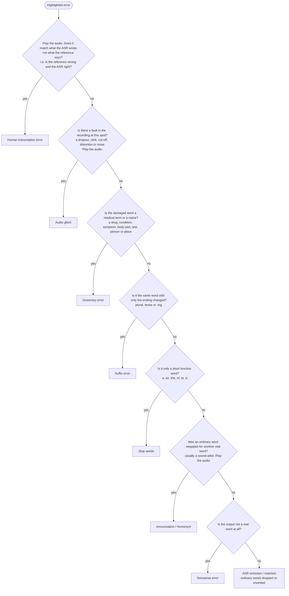

# DRAFT — Quick guide v3 (for the instruction page)

Short on purpose. Fuller reasoning and examples are in the companion document.
Not deployed.

---

## For each error, pick two things

1. **Why did it go wrong?** One label.
2. **How bad is it clinically?** One severity.

---

## Step 1 — The label. Follow the chart, stop at the first "yes".

Three things to remember:

- **Start from the word, not the sound.**
- **A medical term is always Dictionary**, even if only the ending changed
  (`abdominal→abdomen`).
- **One word, one label.** Two labels only when two words failed for different reasons.

**Audio glitch:** A fault in the recording at this spot. This includes a dropout, distortion, a click or pop, a cut-off, or a burst of noise over the speech. An accent, or fast, slurred or mumbled speech, is not a glitch. If a glitch hides a medical term, it is still Audio glitch. *e.g. a word cut off mid-syllable; a click or dropout where a word should be.*

---

## Step 2 — The severity

**Does the word carry clinical content?** (diagnosis, symptom, medication, procedure,
number, negation)

- **No** → **1 Minor**
- **Yes, and the transcript now says something false** → **3 Severe**
- **Yes, and the fact is just missing or garbled** → **2 Moderate**

**3 = misleading. 2 = missing. 1 = no clinical content.**

| Example | Severity |
|---|---|
| `[SUB:gastrings->gallstones]` | 3 — a different diagnosis that reads as true |
| `[SUB:worse->yeah]` | 2 — the course of the symptom is lost, nothing false |

---

## Before you submit

- Did I follow the chart from the top?
- Did I play the audio for Human transcription error, Audio glitch and Annunciation / Homonym?
- Is my severity wrong (3), missing (2), or no clinical content (1)?
